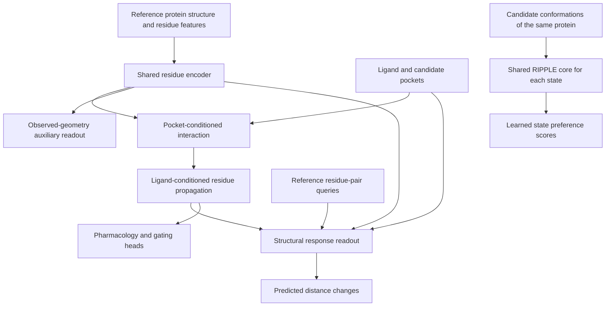

# Ion-channel extension: first implementation

Audit date: 2026-10-16. The objective is ligand-conditioned conformational and
functional response of the **same ion-channel protein**. Membrane environment
is deferred. This extends the five-source DTI/pocket/function design.

For the research context and terminology, start with [design.md](design.md).
This document is the technical record of the added data and local execution,
not a report of completed channel-model training.

## What Was Completed

1. A reproducible audit of three non-PIEZO channel families, with official raw
   structures, biological assemblies, per-residue SIFTS maps, pharmacology and
   chemical structures cached locally.
2. Six explicit geometric landmarks, 16 observed geometry values and 10
   structural differences. Geometry and drug-effect evidence remain separate.
3. A geometry dataset, structure-response branch, shared-weight multistate
   comparison, masked losses and curriculum stages. A real-data geometry smoke
   optimization and one complete model forward/backward pass have run.

**Full five-source pretraining and channel-response fine-tuning have not run.**
The production feature cache, audited sequence splits and full training loop
remain unfinished. The pilot contains no curated strong labels for ligand-induced
gating, state-specific binding preference or causal structural response.

## Data Audit

### Download Sources

These channel files were downloaded in addition to the existing five-source
data. Raw downloads are under `data/raw/channels/` (about 18 MB in this snapshot).
They use official public endpoints:

| Data | Official source / example | Local cache |
|---|---|---|
| PDB entry and construct metadata | [RCSB Data API](https://data.rcsb.org/rest/v1/core/entry/3J5P) | `<PDB>/entry.json`, `entity_*.json` |
| Complete biological assemblies | [RCSB assembly mmCIF](https://files.rcsb.org/download/3J5P-assembly1.cif.gz) | `<PDB>/assembly1.cif.gz` |
| Exact residue mapping | [PDBe SIFTS XML](https://ftp.ebi.ac.uk/pub/databases/msd/sifts/xml/3j5p.xml.gz) | `<PDB>/sifts.xml.gz` |
| Pharmacology observations | [GtoPdb interactions release](https://www.guidetopharmacology.org/DATA/interactions.csv) | `gtopdb_interactions.csv` |
| Ligand identities and SMILES | [GtoPdb ligands release](https://www.guidetopharmacology.org/DATA/ligands.csv) | `gtopdb_ligands.csv` |

`prepare_channels.py` records each file's URL, retrieval time and SHA-256 hash
in `data/processed/channels/provenance.json`; the summary also stores the config
hash. The public CSVs may change with later releases, so the cached release and
hashes identify this particular audit. Local data and outputs are git-ignored.

### Coverage And Curated Structures

The RCSB query covers O35433/Q8NER1 (TRPV1), P56373 (P2X3) and
O93430/P23415 (GLRA1), and returns **156 distinct PDB entries**. This is a
metadata census for those accessions, not 156 verified multistate examples.
Eight structures were selected for the first geometry pass:

| Family / Protein | PDB | Publication-assigned state | Ligand condition | Subunits |
|---|---|---|---|---:|
| Rat TRPV1 / O35433 | 3J5P | closed | apo | 4 |
| Rat TRPV1 / O35433 | 3J5Q | open | RTX + DkTx | 4 |
| Rat TRPV1 / O35433 | 3J5R | partially activated | capsaicin | 4 |
| Human P2X3 / P56373 | 5SVJ | closed | apo | 3 |
| Human P2X3 / P56373 | 5SVK | open | ATP | 3 |
| Human P2X3 / P56373 | 5SVL | desensitized | ATP | 3 |
| Zebrafish GlyR alpha1 / O93430 | 3JAD | closed | strychnine | 5 |
| Zebrafish GlyR alpha1 / O93430 | 3JAE | open | glycine | 5 |

State assignments describe the published structures and do not establish a
drug's effect in arbitrary conditions. The stored metadata retains construct
sequence, mutation count, species, method, resolution and citation. Raw mmCIF
files preserve additional preparation conditions and modeled components.

Important differences found during extraction:

- 3J5Q has RTX and the DkTx toxin together. It is not the capsaicin structure.
- 5SVK's asymmetric unit contains two channel chains, whereas assembly 1 is a
  trimer. Assembly-generated chains such as A-2 must map back to source chain A
  for SIFTS, while retaining their own identity in the model graph.
- 5SVJ and 5SVK have three reported construct mutations; 5SVL has zero.
  Open-to-desensitized comparison therefore has a construct confound as well
  as ATP being present in both structures.
- GlyR's PDB author residues P266/L277 map to UniProt positions 274/285.
  Author numbering cannot be copied from another species or treated as a
  fixed UniProt offset.
- Association with a ligand in a paper does not guarantee explicit ligand
  coordinates in the deposited structure. No native contact labels are created
  by this pilot pipeline.

The GtoPdb 2026.3.1 public release supplies **103 pharmacology records**:
TRPV1 64, P2X3 17 and GLRA1 22. They cover human 75, rat 23 and mouse 5.
There are 67 records with a PMID or URL, 83 ligand records and 73 valid SMILES.
After requiring a reference, an accession, usable chemistry and an eligible
small-molecule type, **58 effect labels** and **42 mechanism labels** are usable.
These counts overlap and are not a count of unique supervised compounds.

Raw Type/Action, species and source references are preserved. Class mappings
live in `configs/channel_pilot.json`. Blockade is an inhibitory pharmacology
effect, but is never automatically labeled as promotion of channel closing.
Allosteric modulators without a supported coarse effect mapping remain missing.

## First Geometry Targets

For each landmark, compute the mean Euclidean C-alpha distance over **all
unordered pairs of different subunits**. A tetramer contributes six pairs, a
trimer three and a pentamer ten. Require all expected subunits, matching residue
identities and valid per-residue SIFTS mappings. Units are Angstrom.

This quantity is invariant to rotation, translation and arbitrary homomer chain
ordering. It is a backbone geometry descriptor, **not a solvent-accessible pore
radius, a conductance estimate or a universal open/closed classifier**.

| Family | First landmark | Second landmark | Values by structure, in the same order |
|---|---|---|---|
| TRPV1 | I679, lower gate | G643, filter | 3J5P: 8.308 / 6.096; 3J5Q: 11.563 / 9.045; 3J5R: 10.112 / 5.799 |
| P2X3 | I323, TM2 | V334, TM2 | 5SVJ: 7.538 / 15.621; 5SVK: 18.500 / 14.171; 5SVL: 21.186 / 8.694 |
| GlyR alpha1 | L277, M2 9-prime | P266, M2 minus-2-prime | 3JAD: 10.495 / 9.452; 3JAE: 14.322 / 11.614 |

Five comparisons yield two deltas each: 3J5P to 3J5Q, 3J5P to 3J5R,
5SVJ to 5SVK, 5SVK to 5SVL, and 3JAD to 3JAE. These are labeled
`geometry_comparison_mask`, with construct compatibility and exclusion reasons.
**They are not automatically copied into `geometry_response` supervision.**
For example, capsaicin-associated TRPV1 has a lower-gate difference of +1.804 A
but a filter difference of -0.297 A. One widening distance does not establish
that the complete channel is conducting.

## Model Contract



- `GeometryQueries.indices` has shape `[B, metrics, pairs, 2]`; the pair mask
  has shape `[B, metrics, pairs]`. Indices always reference the input structure.
- `geometry_snapshot` reconstructs observed geometry from encoded reference
  residues. Its readout never directly receives the measured pair distance or
  ligand. This auxiliary objective trains structural representations.
- `geometry_delta` reads reference residue states, propagated latent changes,
  ligand context and reference distance. Its loss uses `geometry_response`
  labels only. Predicted target pair distances are constrained to be nonnegative.
- The existing `delta_tokens` remain latent features. They are not coordinate
  displacements; this implementation does not generate a new all-atom structure.
- `gating_logits` has classes `0=promotes opening`, `1=promotes closing`,
  `2=no gating change`. Missing evidence is not class 2. These classes require
  relevant functional intervention evidence, not just agonist/blocker names.
- `RIPPLEMultiState` runs one core with shared weights over several conformations.
  It checks protein identity, construct compatibility, split group and identical
  ligand inputs. State scores are learned rankings, not free energies or
  equilibrium populations. State labels and target coordinates are not inputs.
- Protein-state, candidate-pocket and ligand-conformer axes remain separate.
  Every state's biological identity and split group stay the same.
- New objectives require explicit evidence masks. Missing labels contribute
  exactly zero loss. Padded, unavailable and out-of-range queries are excluded.

The added curriculum stages are `structure` (snapshot geometry) and `channel`
(evidence-supported response/gating/state preference). `channel` must be skipped
for objectives with no eligible labels. GtoPdb currently enables only the existing
effect/mechanism objectives, not the new gating or preference objectives.

## Reproduction And Artifacts

Run from the repository root. Reuse the project `.venv` if it already exists;
a fresh checkout needs an environment such as `uv venv --python 3.12 .venv`.
The data preparation command uses the network on a cache miss. The `--offline`
form only works after all required raw files have been cached.

```bash
uv pip install --python .venv/bin/python -r requirements-data.txt torch einops pytest
.venv/bin/python scripts/ripple/prepare_channels.py
.venv/bin/python scripts/ripple/prepare_channels.py --offline
.venv/bin/python scripts/ripple/smoke_channel_geometry.py --steps 64
.venv/bin/python -m pytest tests/ripple tests/test_source_alignment.py -q
```

| Path | Contents |
|---|---|
| `data/raw/channels/` | Official cached CSV, JSON, assembly mmCIF and SIFTS XML |
| `data/processed/channels/provenance.json` | Source URLs, retrieval times and SHA-256 hashes |
| `data/processed/channels/census.json` | The 156 entry IDs in the accession-scoped census |
| `data/processed/channels/states.json` | Structure identity, conditions and state metadata |
| `data/processed/channels/structures/*.json` | Complete channel C-alpha coordinates and exact residue keys |
| `data/processed/channels/geometry.parquet` | Observed geometry and reference pair indices |
| `data/processed/channels/structure_pairs.parquet` | Structural deltas, compatibility and evidence masks |
| `data/processed/channels/pharmacology*.parquet` | Raw evidence and eligible effect/mechanism labels |
| `data/processed/channels/ligands.parquet` | Source chemistry keyed by GtoPdb ligand ID |
| `outputs/channel_geometry_smoke/` | Smoke report and a structure-subgraph checkpoint |

## Local Smoke Check

The check ran on the **local ARM64 Mac CPU, using 2 threads**, without a GPU or
remote server. `smoke_channel_geometry.py` uses its own small configuration;
it does not instantiate the production 128-dimensional feature configuration.

| Setting | Actual smoke configuration |
|---|---|
| Hidden dimension | 32 |
| Residue features | Explicit 21-way amino-acid identities, not pretrained PLM embeddings |
| Geometry samples | 8 structures, 2 observed metrics per structure |
| Batch / updates | One structure per update, 64 updates, cycling through all 8 |
| Optimizer | AdamW, learning rate 0.003, gradient clipping 5.0, seed 83 |
| Updated parameters | Residue encoder, protein fusion and snapshot geometry readout |
| Optimization target | Current observed geometry, not ligand-induced geometry change |
| Evaluation | Training samples only; no held-out split |

The forward subgraph is residue encoding, sequence/structure fusion and the
snapshot readout; unused response inputs are zeroed. The response and gating
heads are not optimized by this loop. Training MAE changed from **10.724 to
2.935 A** across the 16 observed metrics. This checks optimization mechanics,
not predictive performance on new proteins or compounds.

After the 64 updates, the script also performs one complete forward/backward
pass on **5SVJ + ATP**. The only supervised outputs are the two current-geometry
values. **There is no optimizer step after this full-model backward pass.**
ATP chemistry comes from the documented human P2X3 record; the protein-level
agonist label is not transferred to the mutated 5SVJ construct. Raw RDKit atom
features are padded to form the smoke chemical tokens; missing 1D embeddings,
poses and candidate pockets are explicitly masked.

The checkpoint contains only the trained structure subgraph and cannot serve
as a trained DTI, structural-response or gating predictor. The local report's
`geometry_response`, `gating`, `state_preference` and `effect` label counts for
the complete-model check are all zero. The 103 pharmacology records were
prepared as data; they were not used for a pharmacology optimization run here.

The last automated check passed 42 tests covering geometry invariance, exact assembly/SIFTS mapping, ligand
sensitivity, propagation gradients, absent-label masking, state permutation,
construct/identity checks and the no-pose fallback. These are implementation
checks and do not establish biological prediction quality.

## Remaining Work

The new functional objective needs additional **evidence**, not just more generic
affinity records: matched ligand/concentration/construct/assay conditions,
state-specific binding measurements, or functional measurements that distinguish
gating modulation from pore block. Matched apo/holo structures can be curated as
weaker ligand-associated response supervision with their evidence level retained.
That requires a separate audited mask and must not be described as causal proof.

Build production residue/drug embeddings and reference-only candidate pockets,
finish the full feature cache and training loop, and audit sequence-cluster splits
before large-scale training. The pilot uses conservative family groups, but this
does not replace the full 30-percent homology audit. PIEZO1/2 remain reserved for
external evaluation; their homolog exclusion has not been fully audited here.

Primary structural references:
[TRPV1 apo](https://doi.org/10.1038/nature12822),
[TRPV1 conformations](https://doi.org/10.1038/nature12823),
[P2X3 gating cycle](https://doi.org/10.1038/nature19367),
[GlyR conformations](https://doi.org/10.1038/nature14853).
