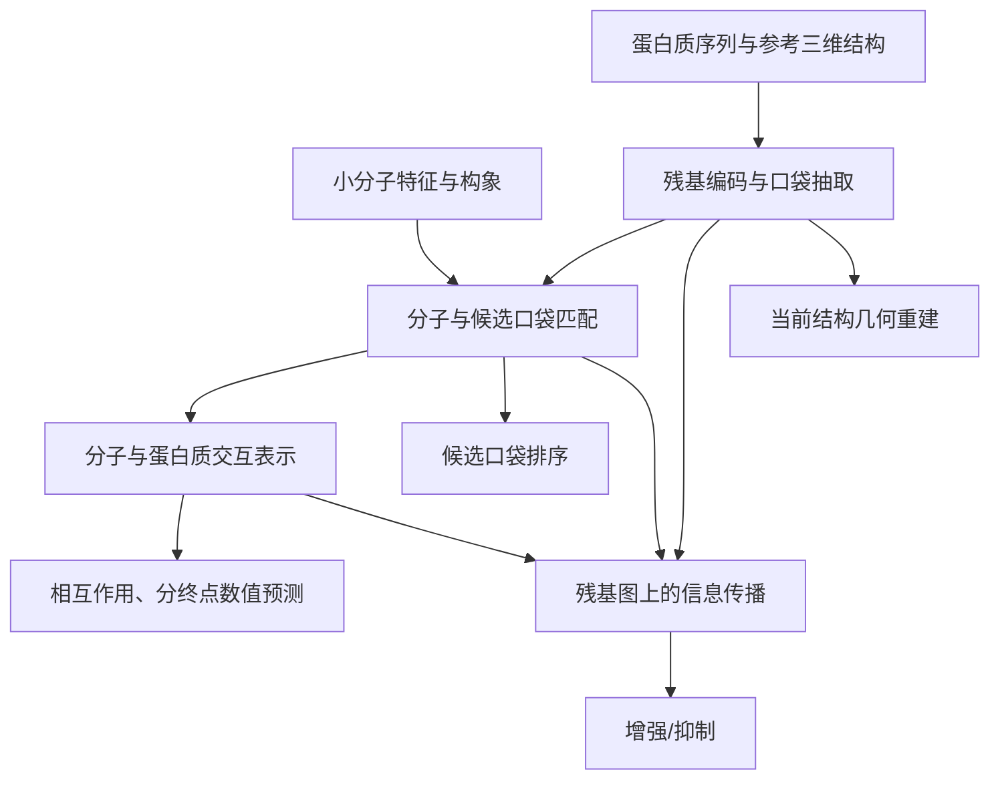

# 模型：先学结合，再学通道作用

更新：2026-10-17。数据见 [DATA.md](DATA.md)，执行方式见 [TRAINING.md](TRAINING.md)。

给定小分子和通道蛋白，首版目标是给出结合相关排序、候选口袋，以及在存在相互作用前提下的增强/抑制倾向，最后用于 PIEZO1/2 筛选。以下是确定的方案，尚无正式训练性能可报告。

## 1. 输入是什么

| 输入 | 网络实际接收 | 含义 |
|---|---|---|
| 小分子 SMILES | 分子序列特征、分子图特征、少量三维构象 | 化学组成与自身空间形状 |
| 蛋白质序列 | 与每个残基对应的特征 | 每个位置是什么氨基酸 |
| 蛋白质参考三维结构 | 残基坐标、空间邻接图、有效性掩码 | 残基在空间中的排列 |
| 预先检测的候选口袋 | 每个口袋包含的残基索引和检测分数 | 若干可能结合的区域 |
| 测量类型（数值任务） | Kd / Ki / IC50 / EC50 标识 | 指定需要预测哪一种实验量 |

**蛋白质输入包含立体结构。** 首版每个样本使用一份参考结构，不要求提供药物作用前后的两份结构。跨亚基几何必须使用审核过的完整生物学装配，不能用孤立单链代替。

小分子的三维构象不等于它在蛋白中的真实结合姿势。候选口袋由模型外的检测器生成，不能用测试药物的真实结合坐标提前圈定。

训练还会读取答案标签和标签掩码；推理无需答案。几何辅助任务另给出要重建的参考残基对。

## 2. 残基、口袋和掩码

| 对象 | 直观解释 | 例子 |
|---|---|---|
| 蛋白质 | 由许多残基组成的整体 | 一个多亚基通道 |
| 残基 | 蛋白链上的一个氨基酸单元，在模型中是节点 | A 链第 100 个残基，带有特征和参考坐标 |
| 口袋 | 空间上相邻的一组残基，是蛋白质的局部区域 | 选中第 100、104、230 个节点 |
| 输入掩码 | 标记节点、边、构象等是否真实可用 | 补齐位置为 `False` |
| 标签掩码 | 标记某个任务是否有可信答案 | 缺少药理标签时，不计算该项损失 |

**残基本身不是掩码。** 结合位点标签也不等于输入掩码，不能把测试答案放进输入。

如果输出一个高分口袋，可以通过节点索引查回其链、原始残基编号、序列编号和参考坐标。多条链可能有相同残基编号，因此必须保留链身份。这里输出的是参考结构已有位置，不是药物作用后残基移动到的新位置。

## 3. 两阶段启用哪些任务

两个阶段沿用同一个模型，阶段二加载阶段一权重。不同样本只计算自身有可信标签的任务。

| 任务 | 阶段一：基础预训练 | 阶段二：通道专项微调 | 完成训练后如何使用 |
|---|---|---|---|
| 相互作用分类 | 有可靠实验正负标签时启用 | 基础任务回放 | 候选评分，校准后才可解释为概率 |
| 分测量类型的数值预测 | 启用 | 基础任务回放 | 对指定终点输出一个数值 |
| 候选口袋排序 | 启用 | 基础任务回放 | 输出口袋分数及对应残基 |
| 增强/抑制二分类 | 关闭 | 主任务 | 在存在相互作用前提下判断方向 |
| 当前结构几何重建 | 关闭 | 辅助任务 | 检查结构表示，是否改善分类由对照实验判断 |

阶段一的残基结合注释用于监督候选口袋覆盖真实结合区域，不代表已经学会所有残基的功能。没有测量的药物–蛋白组合不能直接当作负样本。

阶段二混合通道药理、当前结构几何和基础任务回放，初始批次比例为 60% / 20% / 20%。药理样本与结构样本可以分别提供标签，不要求每条记录同时拥有全部答案。

增强/抑制只说明作用方向，不能独立证明药物有效；抑制也可能来自孔道阻塞，不一定意味着促进通道关闭。

## 4. 模型如何连接

残基传播让结合区域的信息沿蛋白图参与作用分类。传播权重与残基重要性是待验证的模型分析，不能直接解释成实验确认的功能位点、作用路径或物理能量流；`delta_tokens` 是隐藏特征变化，不是三维位移。

当前几何任务重建参考残基之间的距离，单位为埃。编码器已经读取该结构，因此它是结构表示的重建辅助，不能证明模型预测了药物引起的结构变化，也不能把距离直接换算成电流。

## 5. 输出与代码状态

| 输出接口 | 首版含义 |
|---|---|
| `predictions.interaction_logit` | 有可靠分类训练后使用的相互作用分数 |
| `predictions.affinity` | 对指定终点输出一个值，单位和变换沿用训练标签；不一次输出四种实验量 |
| `match.pocket_weight` | 对输入候选口袋排序，导出时映射回链、残基编号与参考坐标 |
| `predictions.effect_logits` | 计划为增强/抑制两类；当前代码默认三类，正式训练前必须修改 |
| `predictions.geometry_snapshot` | 当前结构几何的辅助重建值 |

Kd/Ki 与 IC50/EC50 分别代表不同实验量，不能混作同一种数值。当前未知测量类型的编号处理还需修正，未知类型样本不参与数值回归。旧药理标签中的未知/其他应排除，不能合并为抑制。

首版以下任务权重全部设为 `0`：独立功能残基分类、精细机制分类、变构口袋判别、结合姿势排序、药物诱导结构响应、门控方向、结构状态偏好和非结合扰动约束。稀疏功能注释不能把未注释残基变成负例；现有多结构记录也不等于经过核验的干预配对。

**前向计算返回数值，不代表该输出已经训练可用。** 现有 `channel`、`joint` 等旧训练枚举不能直接代替本次两阶段配置。正式缓存、批处理、训练循环和推理导出仍需接通。

详细接口直接看源码，避免重复维护字段表：

| 内容 | 代码 |
|---|---|
| 总模型、输入 `RIPPLEBatch` 与输出 `RIPPLEOutput` | [model.py](../src/ripple/model.py) |
| 残基编码、口袋抽取与口袋匹配 | [pocket_encoder.py](../src/ripple/pocket_encoder.py)、[pose_confidence.py](../src/ripple/pose_confidence.py) |
| 交互融合与残基传播 | [interaction.py](../src/ripple/interaction.py)、[propagation.py](../src/ripple/propagation.py) |
| 任务输出、几何查询与损失 | [task_heads.py](../src/ripple/task_heads.py)、[structure_response.py](../src/ripple/structure_response.py)、[training.py](../src/ripple/training.py) |

## 6. PIEZO 最终交付

PIEZO1/2 及其同源家族在两阶段有监督训练、验证和调参中隔离，冻结模型后用于外部应用。交付候选排名、增强/抑制倾向、高分候选口袋与参考残基位置；相互作用分类分数仅在相应任务确实训练并验证后交付。

已知 PIEZO 对照与新候选分开报告，未知组合不作为阴性统计准确率。首版未显式输入膜张力或机械刺激条件，候选结论需后续实验验证。
