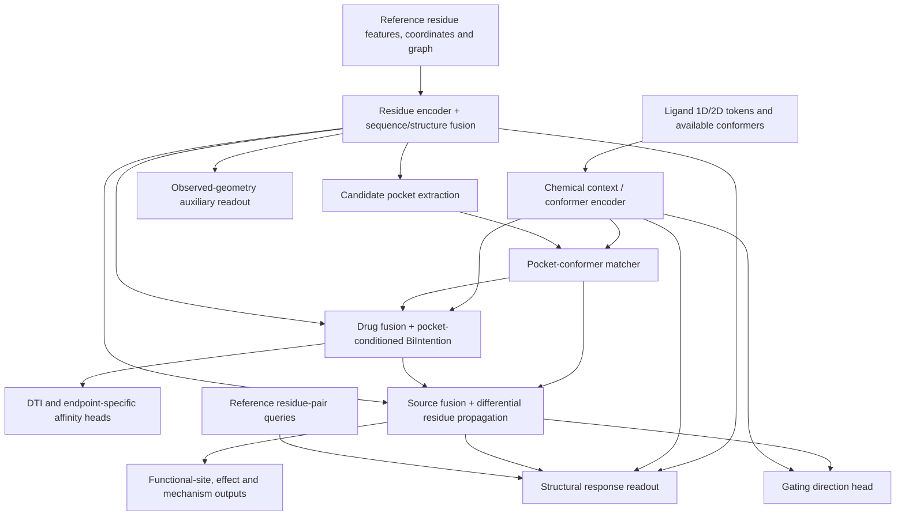

# RIPPLE-DTI Network And Training Contract

Updated: 2026-10-16. This document describes the current `src/ripple/` interfaces,
not trained scientific performance. Start with [design.md](design.md) for the
research context, and [IMPLEMENTATION_PLAN.md](IMPLEMENTATION_PLAN.md) for gaps.

The original interaction/pocket/propagation model remains the base. The channel
extension adds geometry, gating and shared-weight state comparison. Legacy TAMR
encoders may supply compatible features, but production feature extraction and
the full RIPPLE cache/training loop are not connected yet.

## Data Flow

`RIPPLEDTI.forward` creates one shared reference residue representation for
pockets, protein resampling and propagation. The matcher preserves the ligand
conformer axis until it scores pocket/conformer combinations. Pose confidence
softly modulates the interaction; it is not a prerequisite for DTI prediction.

With no valid conformers, pocket weights fall back to the detector prior and
the local context uses selected pocket features plus chemical context. The DTI
path stays finite. The atom-derived propagation source can still be zero in this
case: a working DTI fallback is not a guarantee of nonzero structural response.

DTI/affinity read global/local interaction features; they do not require the
propagation output. Effect/mechanism use the predicted functional state. All
these heads currently require formal training and held-out validation.

## Input Contract

`RIPPLEBatch` is defined in `src/ripple/model.py`. Dimensions are batch `B`,
ligand conformers `Kc`, atoms `Na`, residues `L`, edges `E`, pockets `Kp`,
residues per pocket `Np`, hidden dimension `D`.

| Field | Shape | Meaning |
|---|---|---|
| `drug_1d_tokens`, `drug_1d_mask` | `[B,N1,D]`, `[B,N1]` | Chemical sequence tokens and availability |
| `drug_2d_tokens`, `drug_2d_mask` | `[B,N2,D]`, `[B,N2]` | Molecular graph tokens and availability |
| `atom_features`, `atom_coords`, `atom_mask` | `[B,Kc,Na,Fa]`, `[B,Kc,Na,3]`, `[B,Kc,Na]` | Per-conformer atoms |
| `conformer_mask`, `conformer_energy` | `[B,Kc]` | Available conformers and energies |
| `residue_features`, `residue_coords`, `residue_mask` | `[B,L,Fr]`, `[B,L,3]`, `[B,L]` | Unpooled reference residues |
| `edge_index`, `edge_mask`, `edge_features` | `[B,2,E]`, `[B,E]`, optional `[B,E,Fe]` | Sparse residue graph |
| `pocket_indices`, `pocket_mask` | `[B,Kp,Np]` | Reference-residue indices and padding mask |
| `pocket_valid_mask`, `pocket_score` | `[B,Kp]` | Available candidate pockets and detector confidence |
| `protein_sequence_tokens` | optional `[B,L,D]` | Precomputed compatible sequence representation |
| `endpoint_type` | optional `[B]` | Endpoint conditioning; data masks exclude unknown affinity targets |
| `geometry_queries` | optional `GeometryQueries` | Reference pair groups described below |
| `function_mask` | optional `[B,L]` | Compatibility field; ignored by propagation |

Candidate pockets are inputs produced independently of test ligand coordinates.
Native binding residues are labels. The label availability mask in `RIPPLELabels`
is distinct from geometric input padding masks.

The protein-state axis is not an extra `Kc` or `Kp` axis. A protein structure
can contain multiple biological subunits; residue identity must preserve both
assembly chain and mapped UniProt position.

## Output And Label Contract

`RIPPLEOutput.predictions` contains task readouts. The output also exposes
`pockets`, `match`, `interaction`, `propagation`, `apo_tokens`, `structure_gate`
and `fused_source` for analysis.

| Prediction / quantity | Supervision in `RIPPLELabels` | Meaning |
|---|---|---|
| `interaction_logit` | `interaction`, `interaction_mask` | Interaction classification |
| `affinity` | `affinity`, `affinity_mask` | One scalar conditioned on the sample's endpoint |
| `match.pocket_weight` | `native_pocket_index`, `native_pocket_mask` | Candidate pocket selection |
| `propagation.sink_logits` | `function_label`, `function_mask` | Residue-level annotated-site prediction |
| `effect_logits`, `mechanism_logits` | Corresponding target and mask | Pharmacology categories |
| `match.pose_quality_logits` | `pose_quality`, `pose_mask` | Within-pocket pose ranking; target order is negative RMSD |
| `allosteric_pocket_logits` | `allosteric_pocket`, `allosteric_pocket_mask` | Optional pocket annotation |
| `geometry_snapshot` | `geometry_snapshot`, `geometry_snapshot_mask` | Current observed geometry from encoded residues |
| `geometry_delta`, `geometry_target` | `geometry_response`, `geometry_response_mask` | Predicted change and resulting geometry |
| `gating_logits` | `gating`, `gating_mask` | Promotes opening / promotes closing / no gating change |

`affinity` is not a four-column output: endpoint-specific conditioning keeps
Kd/Ki/IC50/EC50 distinct. Endpoint IDs are 0/1/2/3 respectively; 4 is unknown.
Unknown/censored labels must be masked appropriately by the data layer.

General effect/mechanism categories are separate from gating. Their source
mappings are in `configs/channel_pilot.json`. A blocker label does not become
"promotes closing". Absent evidence is never the "no gating change" class.

`delta_tokens` represent latent differences, not coordinate displacements. Edge
flux and sink weights are predictive quantities, not measured energy flow.

## Geometry And Multiple States

`GeometryQueries.indices` is int64 `[B,M,P,2]`, with boolean `pair_mask` of shape
`[B,M,P]`: each of `M` metrics averages up to `P` reference-residue pairs.
Masked, self, out-of-range or unavailable pairs are excluded. Coordinates and
labels use Angstrom; target-state coordinates are not part of the response input.

`StructureResponseHead` has separate readouts for current geometry and predicted
change. The current-geometry readout uses residue embeddings, without directly
reading the pair distance or ligand. Its encoder can still use reference geometry.
The response readout uses reference residue states, propagated latent differences,
chemical context and reference distance. Predicted target pair distances are
constrained to be nonnegative. These metrics are not solvent-accessible radii.

`RIPPLEMultiState.forward(batches, state_mask, identities)` accepts one batch per
candidate conformation. Metadata must identify the same protein, matching
construct sequences and a common split group; ligand inputs must match exactly.
The wrapper shares one `RIPPLEDTI` and returns state scores, availability and
normalized preference scores. These are learned rankings, not free energies or
equilibrium state populations.

Preference supervision uses `state_preference` and `state_preference_mask`, with
the multistate output passed to `RIPPLEMultiTaskLoss`. At least two candidates
must be valid. The current pilot has no eligible strong preference labels.

## Losses And Stage Policies

`src/ripple/training.py` provides masked losses, `configure_training_stage`,
`stage_loss_weights` and optimizer parameter grouping. New geometry, gating and
preference targets require explicit evidence masks. Missing labels contribute
zero loss; source eligibility is declared in `src/ripple/data/schema.py`.

| Stage | Enabled objectives | Current run status |
|---|---|---|
| `pocket` | Native pocket, allosteric pocket, pose ranking | Policy implemented; formal data cache/run pending |
| `dti` | Interaction, affinity, native pocket | Policy implemented; formal run pending |
| `propagation` | Function, effect, reliable nonbinder delta | Policy implemented; formal run pending |
| `pharmacology` | Effect, mechanism, reliable nonbinder delta | Policy implemented; curated pharmacology subset available |
| `structure` | Observed geometry | Policy implemented; only the local small subgraph smoke run executed |
| `channel` | Geometry response, gating, state preference, reliable nonbinder delta | Policy implemented; response/preference evidence still missing |
| `joint` | Every available objective | Policy implemented; no formal joint optimization run |

These are policies, not proof that a complete curriculum ran. The production
entry point `src/ripple/train.py` still has a `NotImplementedError` in its loop;
its `CURRICULUM` has not yet integrated the added channel stages. The generic
dataset/collate, feature cache and formal split builder are also unfinished.
For the exact Mac CPU smoke procedure and its limitations, see
[CHANNEL_EXTENSION.md](CHANNEL_EXTENSION.md).
