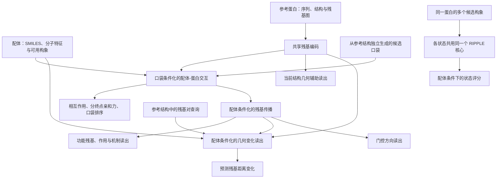

# RIPPLE-DTI：研究背景与当前设计

更新日期：2026-10-16。本文是新成员了解项目的第一份文档，说明已经确定的方向、
模型和数据之间的关系，以及当前工作做到哪里。具体接口见
[NETWORK_MODULES.md](NETWORK_MODULES.md)，后续任务见
[IMPLEMENTATION_PLAN.md](IMPLEMENTATION_PLAN.md)。

## 现在研究什么

总方向是**小分子对离子通道蛋白的调控**。核心问题是：一个小分子与通道上的某些
残基结合后，是否可能引起或稳定特定构象，从而改变通道功能，例如促进开启、促进
关闭或影响脱敏。第一阶段暂不显式建模膜环境。

这里的“可能”很重要：能结合不代表一定引起构象变化；引起局部变化也不代表通道
一定打开；抑制电流还可能来自堵塞孔道。希望模型逐步连接这几层证据，而不是把它们
当作同一个标签。

一个具体例子是：输入同一个 TRPV1 蛋白的参考结构和辣椒素，先预测结合位置与相关
残基，再预测门控区域的几何变化；在有适当监督时，进一步判断功能作用方向。
如果提供这个蛋白的多个候选状态，还希望比较配体与各状态的相容程度。

**目前没有训练好的通道开关预测器。** 已有的是基础模型代码、来源对齐数据、
一批通道结构样例，以及小规模本地运行检查。正式预训练、通道响应微调和独立评测
都还没完成。

## 方向是怎样演进的

| 阶段 | 要解决的问题 | 对当前工作的意义 |
|---|---|---|
| 原始 RIPPLE | 配体是否作用于蛋白、结合在哪个候选口袋、哪些功能残基与作用相关 | 保留为基础 DTI、亲和力、口袋和功能位点任务 |
| 当前扩展 | 同一离子通道的不同构象，以及配体相关的结构和功能响应 | 新增结构几何、响应读出、门控方向和多状态比较 |
| 后续外部验证 | 将训练好的模型用于未参与训练的 PIEZO1/2 | 是计划中的冷靶点案例，目前没有预测结论 |

原来的五个数据来源没有被替换。它们用于学习一般的结合与残基表示；新补的通道结构
和药理证据用于支持新的问题。此前“数据够做最小实验”的结论，适用于基础任务的
规模与对齐验证，不等于新的通道调控任务已有完整监督。

## 几个需要统一的概念

| 概念 | 本项目中的含义 | 不能直接等同于 |
|---|---|---|
| 蛋白构象状态 | 同一蛋白在不同条件下的空间结构，如开放、关闭、脱敏 | 不同蛋白、剪接产生的 isoform、突变体 |
| 配体构象 | 同一个小分子的不同三维构象或结合姿态 | 通道的开放和关闭 |
| 候选口袋 | 一组有空间关系的蛋白残基，表示一个潜在结合区域 | 单个残基、已知真实结合位置 |
| 真实结合残基 | 实验注释或复合物接触计算得到的残基集合 | 推理时可直接使用的候选口袋输入 |
| 功能残基标签 | 结合位点、催化位点、跨膜区等有明确类型的位点注释 | “这个药促进打开”的药理标签 |
| 结构几何标签 | 指定残基之间的距离或距离变化 | 可通透孔径、电导、完整结构变化轨迹 |
| 状态偏好 | 给定配体时，对多个候选蛋白状态的相对评分 | 已校准的结合自由能、平衡态概率 |

开放和关闭在模型中可以分别编码，但仍然属于**同一蛋白的不同状态**，必须留在同一
数据划分组中。突变、截短和构建体差异需要额外记录，不能仅凭相同 UniProt accession
就把两个结构当作严格匹配的状态对。脱敏态也不合并成普通关闭态。

残基注释目前提供的是位置和类别监督，没有实现从功能描述文本中学习并生成机制解释。
SIFTS 负责编号映射；功能位点信息主要来自 UniProt、BioLiP 及相应文献。

## 模型框架

RIPPLE 的全称是 Residue Interaction Propagation from Pocket to Long-range Effects。
下面的图表示已接入的计算分支；分支存在不代表它已经获得有效训练。

基础部分有两个主要建模点：候选口袋参与交互表示；交互相关信息沿残基图传播到
功能区域。Pose 置信度用于重排和软调制，无可用配体姿态时 DTI 路径仍可运行。
但这不保证没有姿态时也有非零传播源，更不保证结构响应预测有效。

扩展部分分开处理两个问题：

- **结构响应**：只给参考结构和配体，预测指定残基距离如何改变。目标状态的坐标只能
  用于制作标签，不能放进这个分支的输入。
- **多状态比较**：输入若干已经给定的蛋白构象，共享模型参数，比较该配体对应的状态评分。
  这不会生成一个原本没有提供的新构象。

代码中的 `delta_tokens` 是隐表示差分，不是残基坐标位移。第一版选择距离变化作为
可核查的结构目标，尚未实现完整三维结构生成、开关速率或门控动力学模拟。

## 五个基础数据来源

这里的“五个”包含三个带配体数据的来源，以及两个身份和注释基础设施。

| 来源 | 实际提供什么 | 在本项目中的用途 | 不直接提供什么 |
|---|---|---|---|
| BindingDB | 配体、靶点身份、Kd/Ki/IC50/EC50 等测量 | 分终点亲和力；确定活性规则后用于相互作用任务 | 通用的结合残基和配体诱导结构变化标签 |
| BioLiP | 结构关联的结合残基、部分催化残基、配体身份 | 结合位置与功能位点监督 | 初版不使用其中转录的亲和力字段；不提供通用门控作用标签 |
| PDBbind | 实验复合物坐标、配体结构、实测亲和力 | 亲和力；从复合物计算真实接触残基 | 独立预测的候选口袋；默认也没有一组质量各异的 docking pose 标签 |
| UniProt | 蛋白序列、身份、物种、位点及功能描述 | 蛋白身份和序列；按类型整理位点标签 | 配体条件下的通道开关或结构响应数据集 |
| SIFTS | PDB 链和残基到 UniProt 的映射 | 对齐 BioLiP、PDBbind 和通道结构中的编号 | 功能、亲和力或作用方向标签 |

PDBbind 的“真实口袋”不需要预测：当前按配体接触计算，验证子集使用 4.0 Å 阈值。
**需要独立预测的是输入候选口袋**，计划从 apo/AlphaFold 参考结构上检测，再用真实
结合残基监督它的选择。不能用测试配体坐标直接定义输入候选口袋。

来源分别保留，一条样本只使用自己实际拥有的标签；不要求每个配体-蛋白对都能在
五个来源中一一配齐。没有注释不是负例，没有测量也不是零亲和力。
Kd、Ki、IC50、EC50 不混成一个回归目标。

五源已做全量元数据初筛，并对 300 个复合物做逐残基检查，其中 254 个的接触残基
完整对齐。这不是最终训练集或代表全库的随机评测。BindingDB 多链记录被保留用于
审计，当前候选策略只纳入可解析的单链靶点，不随意选择复合物中的某一条链。
完整计数和缺口见 [DATA_ALIGNMENT_RESULTS.md](DATA_ALIGNMENT_RESULTS.md)。

## 通道数据新增了什么

这批数据用于验证新目标的数据表示，不代表已经构建了完整通道训练集。

| 内容 | 当前结果 | 可以支持什么 |
|---|---|---|
| TRPV1、P2X3、GlyR alpha1 结构 | 指定 accession 检索命中 156 个 PDB 条目，实际下载核对 8 个结构 | 多状态结构样例及生物学装配处理 |
| 结构几何 | 6 个区域地标，16 个观测值，5 组比较得到 10 个差值 | 当前几何辅助任务；结构差异分析 |
| GtoPdb 药理 | 103 条原始记录；筛出 58 条作用标签、42 条机制标签 | 一般作用与机制监督，计数可重叠 |
| 门控响应和状态偏好 | 当前已整理数据中的可用强监督标签均为 0 | 对应训练尚未启用 |

这里的几何量是完整生物学装配中某一地标残基的**跨亚基 Cα 平均距离**。距离扩大
可能与局部开口有关，但它不是扣除原子半径后的可通透孔径，也不能单独判定导通。

原始文件分别来自 RCSB PDB、PDBe SIFTS 和 GtoPdb 的公开下载接口。
检索范围、8 个 PDB 的身份和状态、引用、来源 URL、哈希及输出文件见
[CHANNEL_EXTENSION.md](CHANNEL_EXTENSION.md)。这批文件是后续补充的，与原有五源分目录存放。

## 监督目标不能互相替代

| 问题 | 需要的标签或证据 | 当前边界 |
|---|---|---|
| 结合在哪里 | 结合残基、接触残基、真实口袋 | 已有来源及对齐样例，正式候选口袋与缓存仍需生成 |
| 哪些残基有注释功能 | 明确类型的功能位点 | 已解析位点；哪些类型进入哪个任务、未注释位置如何处理仍需固化 |
| 当前结构长什么样 | 当前结构坐标导出的几何量 | 已做小规模几何辅助优化 |
| 配体相关的几何变化 | 匹配蛋白构建体、配体和条件的结构对；注明证据等级 | 已有结构比较值，尚未自动作为响应强标签使用 |
| 更偏好哪个状态 | 状态特异的结合测量或适当的比较证据 | 当前未整理到可用强标签；一般亲和力不能重复当作各状态亲和力 |
| 促进打开还是关闭 | 能区分门控调节与孔道阻断的功能实验 | 不能仅凭 agonist、inhibitor 或 blocker 名称赋值 |

静态 apo/holo 配对可以支持较弱的配体相关结构监督，但需要单独标明证据等级和混杂
因素；它不等于直接证明配体引起了所有观测变化。是否增加这种弱监督是后续数据
整理中的明确决策，不是目前已经启用的标签。

## 实际做过哪些运行

2026-10-16 在本地 **Mac ARM64、CPU、2 线程**上进行了小规模检查，没有使用服务器
或 GPU。为了检查数据和梯度，使用了与正式配置不同的 32 维小模型和 21 维氨基酸
类型特征，没有计算大型蛋白语言模型嵌入。

| 运行 | 真正发生的事情 | 不能据此宣称什么 |
|---|---|---|
| 8 个结构、64 次更新 | 每次 1 个结构，只优化结构编码、融合和当前几何读出，目标是当前结构的观测距离 | 没有训练配体引起的距离变化或通道开关 |
| 5SVJ + ATP 全模型检查 | 做一次前向和反向，监督只有当前结构的 2 个几何值；该步没有执行参数更新 | 没有全模型微调，也没有把野生型药理标签赋给突变构建体 |
| 42 项自动化测试通过 | 检查掩码、梯度、编号映射、状态排列和不变性等实现性质 | 不说明科学预测准确率或泛化能力 |

64 次更新中的误差只是在这 8 个结构上的训练误差，没有独立验证集。
`outputs/channel_geometry_smoke/geometry_smoke.pt` 只保存结构子图参数，不能作为正式
DTI、门控预测或 PIEZO 推理模型。运行配置与复现命令见通道扩展文档。

## 后续工作与验证边界

后续有两条相互关联的工作线：基础任务需要候选口袋、正式特征缓存、数据划分和
训练循环；通道响应任务还需要配体、构建体、条件与功能实验能够对应的监督记录。
具体产物与完成判据统一放在 [IMPLEMENTATION_PLAN.md](IMPLEMENTATION_PLAN.md)。

PIEZO1（Q92508）、PIEZO2（Q9H5I1）计划只做外部冷靶点案例，训练前必须完成其
同源排除和泄漏审计。目前只做了直接 accession 排除及通道样例的家族分组，完整
30% 同源聚类和冷启动划分还没有完成。

模型现阶段不支持真实门控动力学、完整全原子结构变化、可靠结合姿态保证或膜环境
效应。残基传播和边通量是预测性表示，不解释为已经恢复了物理能量传播路径。

## 文档与证据怎么对应

- [文档导航](README.md)：按背景、数据、实现和实验记录安排阅读顺序。
- [数据对齐结果](DATA_ALIGNMENT_RESULTS.md)：原有五源的实际计数与失败记录。
- [数据准备](DATA_PREPARATION.md)：五源处理命令、表结构和处理口径。
- [通道扩展](CHANNEL_EXTENSION.md)：新增来源、几何定义、模型接口和本地运行细节。
- [网络契约](NETWORK_MODULES.md)：当前代码的输入、输出、掩码和训练阶段。
- [实施清单](IMPLEMENTATION_PLAN.md)：已完成、未完成以及进入正式实验的条件。

`overview.html` 是早期基础 DTI 方案的历史示意图，不包含当前通道扩展。
统计以相应生成报告为证据，代码是否实现以 `src/ripple/` 和 `scripts/ripple/` 为准。
